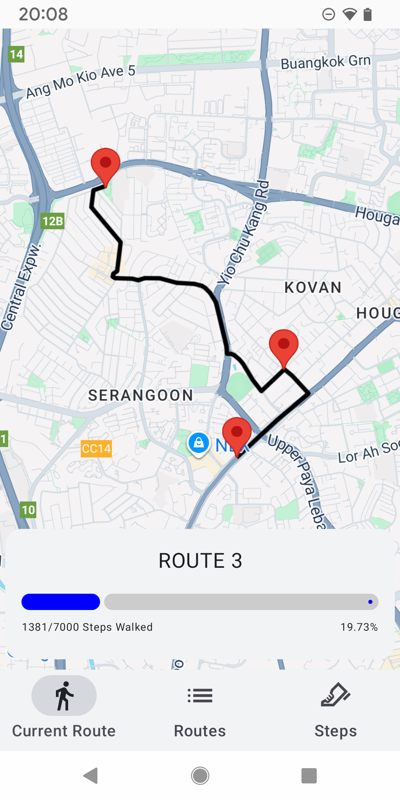
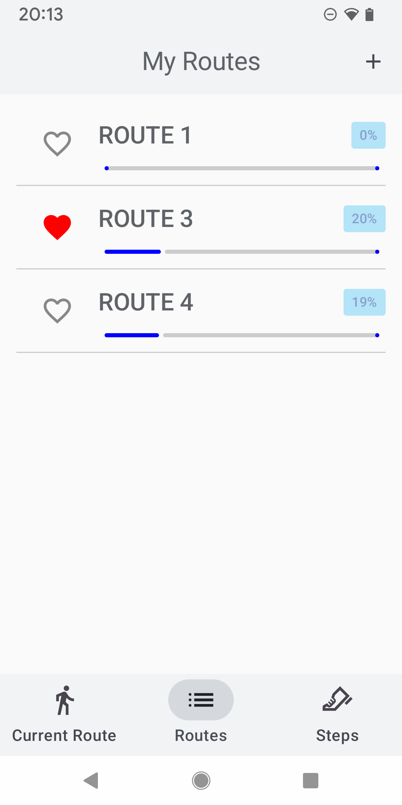
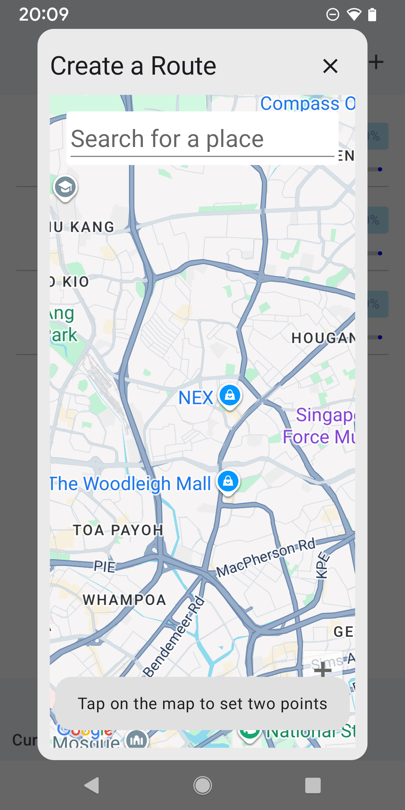
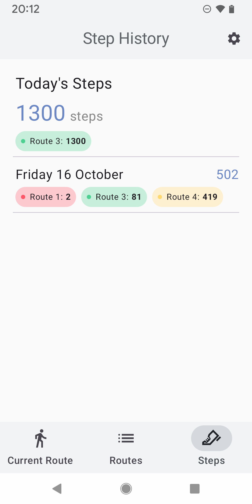

# WalkAnywhere

An Android walking route tracker. Create custom walking routes, track your daily steps along said route, and visualize your progress.

| Main Route | Routes Page | Create Route Page | Step History |
|:---:|:---:|:---:|:---:|
|  |  |  |  |

## Features

### Route Planning
- **Interactive Map Interface** - Tap to place start and end points
- **Place Search** - Search for a location with Google Places autocomplete
- **Automatic Route Calculation** - Uses Google Maps walking directions
- **Step Estimates** - Each route shows the number of steps needed to complete it

### Step Tracking
- **Health Connect Integration** - Records your steps on-device and syncs them via Health Connect
- **Background Sync** - Steps are synced when the app opens and periodically in the background
- **Progress Visualization** - Progress bars showing route completion
- **Step History** - Daily step totals, broken down by route

### Core Functionality
- **Save Multiple Routes** - Create and store unlimited walking routes
- **Main Route System** - Favourite a route to make it your active journey
- **Route Management** - View, reset and delete your routes
- **Progress Persistence** - Automatically saves your walking progress

## Technical Details

### Built With
- **Jetpack Compose** - Declarative UI with Material 3
- **Room** - Persistent data storage
- **Google Maps SDK / Places / Directions API** - Interactive maps, search and routing
- **Health Connect** - Step data storage
- **Play Services Recording API** - On-device step counting
- **WorkManager** - Background step syncing

## Getting Started

### Requirements
- Android Studio (latest stable)
- Android 8.0+ device or emulator (Android 10+ device needed to track real steps)
- Health Connect installed on the device (built in on Android 14+)
- A Google Maps Platform API key with the **Maps SDK for Android**, **Places API (New)** and **Directions API** enabled

### Running the App
1. Clone the repo and open it in Android Studio
2. Add your API key to `local.properties` in the project root:
   ```properties
   MAPS_API_KEY=your_api_key_here
   ```
3. Select your target device/emulator
4. Press **Run** (`Ctrl + R` / `Shift + F10`)
5. Grant the physical activity and Health Connect permissions when prompted

## Usage

### Creating a Route
1. Navigate to **Routes**
2. Tap the **+** button
3. Tap two points on the map, or search for a place
4. Review the calculated route
5. Tap **Save**

### Setting a Main Route
1. Go to **Routes**
2. Tap the heart icon next to any route
3. View your progress on the **Current Route** tab

### Tracking Progress
- Your daily steps automatically count toward your main route
- Progress persists even when changing routes
- Reset a route's progress at any time from the Current Route tab

## License
All rights reserved.

## Credits
Designed and built by Zachary Upstone, 2026
